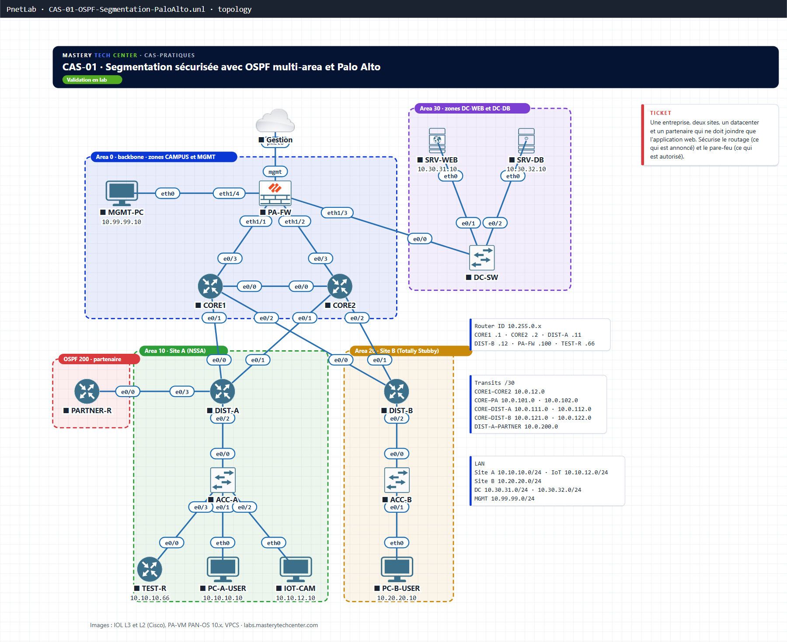

# CAS-01 · Segmentation sécurisée avec OSPF multi-area et Palo Alto

**Parcours :** Cas pratiques · **Niveau :** Avancé · **Durée :** ≈ 6 h · **Nœuds :** 16

Une entreprise, deux sites, un datacenter et un partenaire qui ne doit joindre que l'application web. Tu sécurises l'ensemble à deux niveaux : ce que le routage annonce, et ce que le pare-feu autorise.

## Topologie

| Domaine | Contenu |
|---|---|
| Area 0 | CORE1, CORE2, PA-FW (zones CAMPUS et MGMT), MGMT-PC |
| Area 10 · Site A (NSSA) | DIST-A, ACC-A, PC-A-USER, IOT-CAM, TEST-R |
| Area 20 · Site B (Totally Stubby) | DIST-B, ACC-B, PC-B-USER |
| Area 30 · datacenter | DC-SW, SRV-WEB, SRV-DB (zones DC-WEB et DC-DB) |
| OSPF 200 · partenaire | PARTNER-R |

La matrice de câblage complète et le plan d'adressage sont dans le PDF (pages 4 à 6).

## Documents
- 📘 [Lab complet, solutions incluses (PDF)](docs/CAS-01_Lab-complet.pdf)
- ✅ Résultats obtenus avec captures (PDF) : bientôt disponible

## Fichiers du lab
- Topologie PnetLab / EVE-NG : `topology/CAS-01-OSPF-Segmentation-PaloAlto.unl` (les 16 nœuds câblés, sans configuration : tu la construis en suivant le PDF)
- Schéma : `diagrams/topology.png` et `topology.svg`
- Images : IOL L3 et L2, PA-VM PAN-OS 10.x, VPCS (non fournies)

## Vidéos
- YouTube : bientôt disponible

☕ Ce lab t'a aidé ? [Offrir un café](https://ko-fi.com/masterytechcenter)

---
© 2026 Hilaire TCHOUATEU · Mastery Tech Center · Licence [CC BY-NC-ND 4.0](https://creativecommons.org/licenses/by-nc-nd/4.0/deed.fr)
