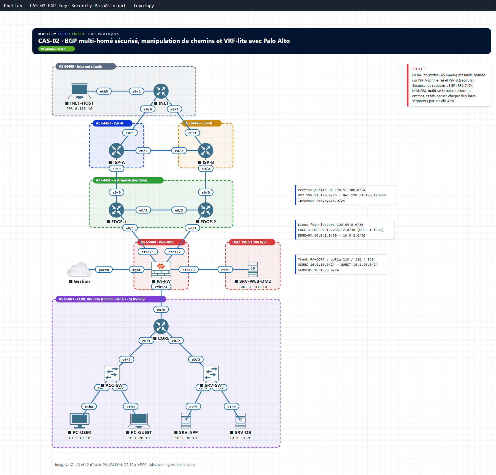

# CAS-02 · BGP multi-homé sécurisé, manipulation de chemins et VRF-lite avec Palo Alto

**Parcours :** Cas pratiques · **Niveau :** Avancé · **Durée :** ≈ 7 h · **Nœuds :** 15 · **Tâches :** 11

NEXA Industries (AS 64496, préfixe PI 198.51.100.0/24) est multi-homée sur deux opérateurs : ISP-A (primaire) et ISP-B (secours). Un Palo Alto protège une DMZ publique et segmente l'interne en trois VRF (USERS, GUEST, SERVERS). À toi de maîtriser tous les leviers de chemin BGP, d'appliquer les recommandations de sécurité du routage Internet (RFC 7454, MANRS) et de faire passer chaque flux inter-segments par le pare-feu.

## Topologie

| Domaine | Équipements |
|---|---|
| AS 64499 · Internet simulé | INET, INET-HOST |
| AS 64497 · ISP-A (primaire, RTBH) | ISP-A |
| AS 64498 · ISP-B (secours, communautés) | ISP-B |
| AS 64496 · entreprise (bordure) | EDGE-1, EDGE-2 (iBGP et OSPF entre loopbacks) |
| AS 65000 · Palo Alto | PA-FW, SRV-WEB-DMZ (DMZ 198.51.100.0/25) |
| AS 65001 · CORE VRF-lite | CORE, ACC-SW, SRV-SW, PC-USER, PC-GUEST, SRV-APP, SRV-DB |

## Ce que tu pratiques

- Sécurité eBGP : MD5, GTSM, maximum-prefix, filtrage des bogons, de tes propres préfixes et de la longueur, anti-fuite de routes
- Trafic sortant : LOCAL_PREF (et pourquoi Weight n'est pas le bon outil)
- Trafic entrant : AS-PATH prepend, communautés du fournisseur, plus-spécifiques en NO_EXPORT, annonce conditionnelle
- MED et sélection par as-path entre les EDGE et le Palo Alto
- RTBH avec la communauté BLACKHOLE (RFC 7999)
- Segmentation VRF-lite : le Palo Alto comme unique point de passage, NAT, App-ID, Zone Protection

## Documents

- 📘 [Lab complet, solutions incluses (PDF)](docs/CAS-02_Lab-complet.pdf) : 11 tâches, résultats attendus et pièges

## Fichiers du lab

| Dossier | Contenu |
|---|---|
| `topology/CAS-02-BGP-Edge-Security-PaloAlto.unl` | Les 15 nœuds câblés selon la matrice, nuage de gestion du Palo Alto, noms d'hôtes chargés |
| `configs/initial/` | Départ : noms seuls (tu construis tout, tâche par tâche) |
| `configs/final/` | Solution nominale des tâches 1 à 9 pour chaque équipement IOS et chaque PC ; `PA-FW-GUI.txt` pour le Palo Alto (interface web) |
| `diagrams/` | Schéma PNG et SVG |

La configuration finale exclut volontairement : la démonstration Weight (tâche 4, à retirer), le déclencheur RTBH (tâche 9, incident ponctuel), les tests de la tâche 10 et le bonus de la tâche 11.

**Images (non fournies) :** IOL L3 et L2 (Cisco), PA-VM PAN-OS 10.x, VPCS. **Packet Tracer :** non disponible pour ce lab (pas de Palo Alto ni de VRF-lite dans Packet Tracer).

Adresses et ASN de documentation (RFC 5737, RFC 5398), ASN privés (RFC 6996) ; mots de passe BGP fictifs.

## Vidéos
- YouTube : bientôt disponible

☕ Ce lab t'a aidé ? [Offrir un café](https://ko-fi.com/masterytechcenter)

---
© 2026 Hilaire TCHOUATEU · Mastery Tech Center · Licence [CC BY-NC-ND 4.0](https://creativecommons.org/licenses/by-nc-nd/4.0/deed.fr)
