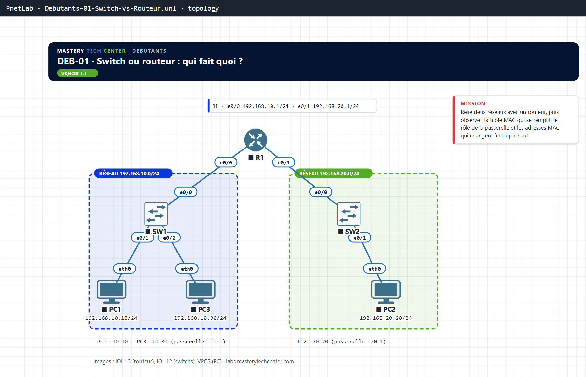

# DEB-01 · Switch ou routeur : qui fait quoi ?

| Parcours | Niveau | Objectif CCNA v2 | Plateforme | Durée |
|---|---|---|---|---|
| Débutants | Débutant | 2.1 switchs et routeurs, couche 2 et couche 3 | Packet Tracer · PnetLab / EVE-NG (IOL, VPCS) | 10 à 20 min |

Le lab de la vidéo DEB-01 : tu construis deux réseaux reliés par un routeur, puis tu **observes** ce que la vidéo montre (table MAC qui se remplit, passerelle, adresses MAC qui changent à chaque saut).

## Topologie



```
                 R1
   e0/0 (G0/0) /    \ e0/1 (G0/1)
             SW1      SW2
            /   \       \
         PC1     PC3     PC2
  192.168.10.0/24       192.168.20.0/24
```

| Équipement | Image PnetLab | Rôle | Adresses |
|---|---|---|---|
| R1 | IOL L3 | Routeur, passerelle des deux réseaux | e0/0 192.168.10.1/24 · e0/1 192.168.20.1/24 |
| SW1, SW2 | IOL L2 | Switchs (VLAN 1, sans configuration) | — |
| PC1, PC3 | VPCS | Postes du réseau 10 | 192.168.10.10 et .30 /24, passerelle .10.1 |
| PC2 | VPCS | Poste du réseau 20 | 192.168.20.20/24, passerelle .20.1 |

Dans la vidéo, les interfaces du routeur s'appellent `G0/0` et `G0/1` (routeur Cisco physique ou Packet Tracer). Sur une image IOL, ce sont `e0/0` et `e0/1` : même rôle.

**Packet Tracer :** construis le lab en 5 à 10 min avec la fiche [docs/PACKET-TRACER.md](docs/PACKET-TRACER.md) (blocs CLI prêts à coller dans `configs/packet-tracer/`).
**PnetLab / EVE-NG :** importe `topology/Debutants-01-Switch-vs-Routeur.unl` (images IOL et VPCS non fournies).

## Ta mission

1. **Configure les PC** (VPCS) : `ip 192.168.10.10/24 192.168.10.1` sur PC1, `ip 192.168.10.30/24 192.168.10.1` sur PC3, `ip 192.168.20.20/24 192.168.20.1` sur PC2.
2. **Le switch apprend.** Sur SW1 : `show mac address-table` (presque vide). Depuis PC1 : `ping 192.168.10.30`. Relance `show mac address-table` : les MAC de PC1 et PC3 sont apparues, avec leur port.
3. **Le switch ne route pas.** Depuis PC1 : `ping 192.168.20.20` échoue. Pourquoi ?
4. **Configure R1** (adresses ci-dessus, `no shutdown` sur les deux interfaces), puis refais `ping 192.168.20.20` depuis PC1.
5. **Observe la passerelle.** Sur PC1 : `show arp`. La MAC associée à 192.168.10.1 est celle de R1 e0/0 : c'est elle que PC1 met en destination pour joindre PC2.
6. **Observe la réécriture.** Sur R1 : `show ip route` (deux réseaux connectés) et `show interfaces e0/1 | include address` : la MAC de sortie vers PC2 n'est pas la même qu'en entrée.

!!! tip "Indice"
    Une trame Ethernet ne quitte jamais son réseau : à chaque saut, l'en-tête de couche 2 est refait. Le paquet IP, lui, traverse de bout en bout.

## Solution

??? success "Afficher la solution"
    ```
    R1(config)#interface e0/0
    R1(config-if)#ip address 192.168.10.1 255.255.255.0
    R1(config-if)#no shutdown
    R1(config-if)#interface e0/1
    R1(config-if)#ip address 192.168.20.1 255.255.255.0
    R1(config-if)#no shutdown
    ```
    **Pourquoi l'étape 3 échoue :** PC1 voit que 192.168.20.20 n'est pas dans 192.168.10.0/24 ; il envoie donc la trame à sa passerelle, qui n'existe pas encore. Les switchs n'ont aucune notion d'adresse IP.

    **Validation :** `ping 192.168.20.20` depuis PC1 réussit ; `show ip route` sur R1 affiche deux routes `C` ; sur PC1, `show arp` contient la MAC de R1. Les configurations corrigées sont dans `configs/final/`.

## Pour aller plus loin

Sur SW2, `show mac address-table` après le ping : on n'y voit **jamais** la MAC de PC1, seulement celle de R1 e0/1. Preuve que le routeur a refait l'en-tête Ethernet.
