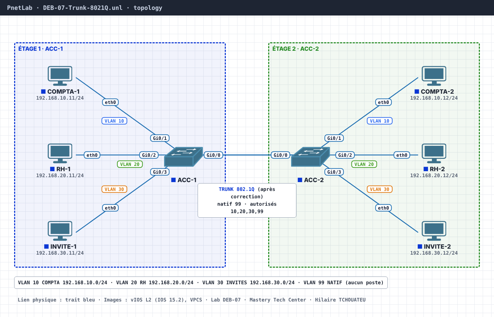

# DEB-07 · Trunk 802.1Q : plusieurs VLAN, un seul câble

**Niveau** : débutant · **Objectif CCNA v2** : 2.1.b, trunks 802.1Q et VLAN natif · **Auteur** : Hilaire TCHOUATEU
**Images** : vIOS L2 (IOS 15.2), VPCS · **Fichier** : `topology/DEB-07-Trunk-8021Q.unl`

## Ticket
« COMPTA-1 (étage 1) ne joint pas COMPTA-2 (étage 2). Ils sont pourtant tous les deux dans le VLAN 10. »

## Topologie


| Nœud | Interface | Vers | VLAN | Adresse |
|---|---|---|---|---|
| ACC-1 | Gi0/0 | ACC-2 Gi0/0 | lien inter-switchs | — |
| ACC-1 / ACC-2 | Gi0/1 | COMPTA-1 / COMPTA-2 | 10 COMPTA | 192.168.10.11 / .12 /24 |
| ACC-1 / ACC-2 | Gi0/2 | RH-1 / RH-2 | 20 RH | 192.168.20.11 / .12 /24 |
| ACC-1 / ACC-2 | Gi0/3 | INVITE-1 / INVITE-2 | 30 INVITES | 192.168.30.11 / .12 /24 |

## Mission
1. Vérifie l'état du lien Gi0/0 (`show interfaces Gi0/0 switchport`).
2. Passe-le en trunk 802.1Q sur les deux switchs, avec le VLAN natif 99 et seulement les VLAN 10, 20, 30 et 99 autorisés.
3. Prouve-le : `show interfaces trunk`, puis un ping de COMPTA-1 vers COMPTA-2.

??? tip "Indice"
    Le lien entre les switchs est en mode accès : il ne transporte qu'un seul VLAN.

??? success "Solution"
    ```
    interface GigabitEthernet0/0
     switchport trunk encapsulation dot1q
     switchport mode trunk
     switchport trunk native vlan 99
     switchport trunk allowed vlan 10,20,30,99
    ```
    Même configuration sur les deux switchs : le VLAN natif doit être identique aux deux bouts.

## Pour aller plus loin
Mets le VLAN natif 1 sur ACC-2 seulement, et regarde les journaux d'ACC-1.

## Historique des versions

- **31/10/2026** : `vtp mode transparent` ajouté aux configurations de ACC-1 et ACC-2. Sans lui, vIOS L2 (mode VTP serveur par défaut) ignore les lignes `vlan` de la configuration de démarrage : les VLAN s'appelaient VLAN0010… et le VLAN natif 99 restait inactif. Fichier `.unl` mis à jour (disposition identique au schéma, image vIOS L2 `…high_iron_20200929`).
