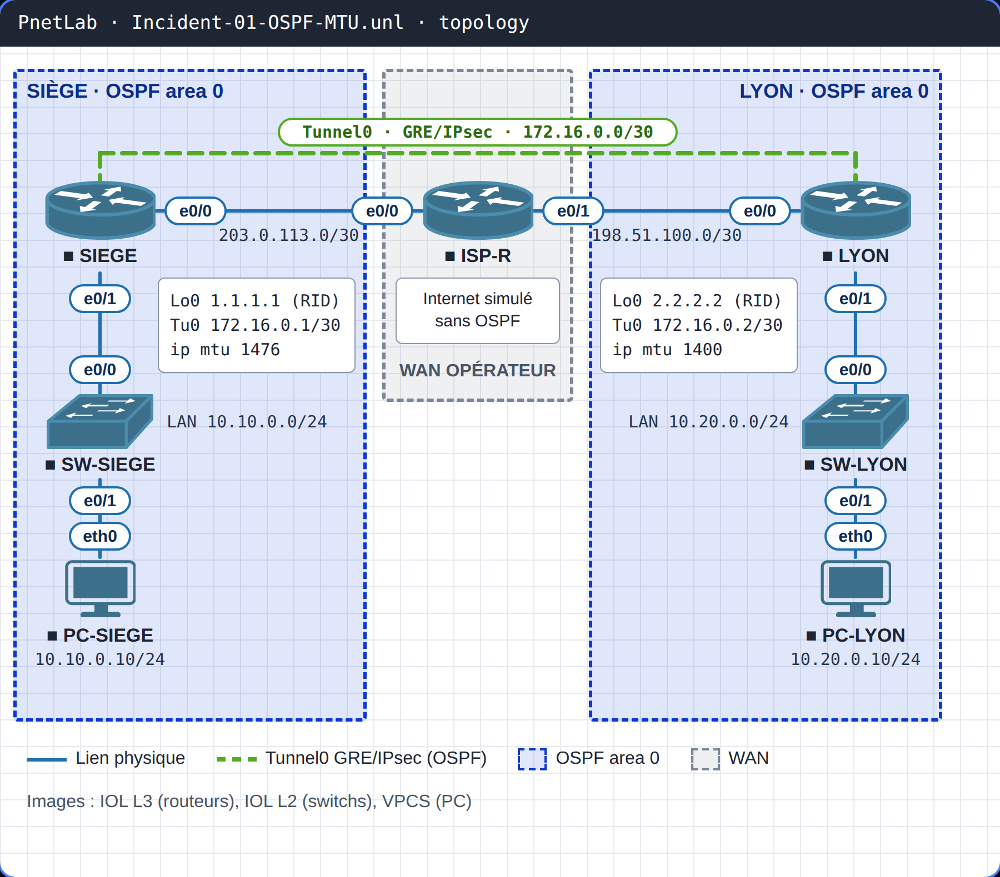

# INC-01 · OSPF bloqué en EXSTART après une migration GRE/IPsec

| Parcours | Niveau | Objectifs CCNA v2 | Plateforme | Durée |
|---|---|---|---|---|
| Incidents en entreprise | CCNA → CCNP | 3.3.a adjacences OSPF · 4.5 VPN IPsec | PnetLab / EVE-NG (IOL, VPCS) | 30 min |

!!! danger "Ticket INC-01 · Priorité P2"
    **Lundi 9 h 02.** Le site de Lyon ne joint plus le siège. Le week-end dernier, le lien Lyon ↔ siège a été migré vers un tunnel **GRE over IPsec**. Le tunnel IPsec est bien monté, les routeurs se voient… mais aucune route OSPF n'est apprise.

## Topologie



| Équipement | Image | Rôle | Adresses clés |
|---|---|---|---|
| SIEGE | IOL L3 | Routeur du siège | Lo0 1.1.1.1 · e0/0 203.0.113.1/30 · e0/1 10.10.0.1/24 · Tu0 172.16.0.1/30 |
| ISP-R | IOL L3 | Internet simulé, sans OSPF | e0/0 203.0.113.2/30 · e0/1 198.51.100.2/30 |
| LYON | IOL L3 | Routeur du site de Lyon | Lo0 2.2.2.2 · e0/0 198.51.100.1/30 · e0/1 10.20.0.1/24 · Tu0 172.16.0.2/30 |
| SW-SIEGE, SW-LYON | IOL L2 | Switchs d'accès (VLAN 1) | — |
| PC-SIEGE, PC-LYON | VPCS | Postes de test | 10.10.0.10/24 · 10.20.0.10/24 |

## Démarrer le lab

1. Importe la topologie du dossier `topology/` dans PnetLab ou EVE-NG (les images IOL et VPCS ne sont pas fournies).
2. Applique les configurations de `configs/initial/` : elles contiennent la panne.
3. Attends une minute que le tunnel IPsec se monte (`show crypto isakmp sa` → `QM_IDLE`).

## Ta mission

1. Constate le symptôme : depuis PC-SIEGE, `ping 10.20.0.10` échoue.
2. Trouve l'état exact du voisinage OSPF entre SIEGE et LYON.
3. Trouve **la preuve** de la cause dans les logs d'un des deux routeurs.
4. Corrige la panne **sans** utiliser `ip ospf mtu-ignore`, et sans dégrader le tunnel IPsec.
5. Valide : adjacence FULL, routes OSPF apprises, ping PC-SIEGE → PC-LYON réussi.

!!! tip "Indice"
    Compare les interfaces Tunnel0 des deux routeurs.

## Solution

??? success "Afficher la solution"
    **Diagnostic.** `show ip ospf neighbor` sur SIEGE montre le voisin 2.2.2.2 bloqué en `EXSTART`. Sur LYON, `debug ip ospf adj` affiche `Nbr 1.1.1.1 has larger interface MTU`.

    **Cause.** Chaque paquet DBD annonce le MTU IP de l'interface. Le Tunnel0 de LYON a été réglé à `ip mtu 1400` pour IPsec ; celui de SIEGE est resté à 1476. LYON rejette les DBD qui annoncent un MTU plus grand que le sien.

    **Correction (on aligne vers le bas).**
    ```
    SIEGE(config)#interface tunnel0
    SIEGE(config-if)#ip mtu 1400
    SIEGE(config-if)#ip tcp adjust-mss 1360
    ```

    **Pourquoi pas l'inverse ?** Remonter LYON à 1476 relancerait l'adjacence, mais les paquets proches de 1476 octets seraient fragmentés après chiffrement IPsec. `ip ospf mtu-ignore` masque le symptôme sans corriger la cause : c'est un pansement.

    **Validation.** `show ip ospf neighbor` → `FULL/  -` ; `show ip route ospf` → 10.20.0.0/24 via Tunnel0 ; `ping 10.20.0.10` depuis PC-SIEGE réussit. Les configurations corrigées sont dans `configs/final/`.

## Pour aller plus loin

Teste la limite du tunnel depuis SIEGE : `ping 10.20.0.1 source 10.10.0.1 size 1400 df-bit` passe, alors que `size 1401 df-bit` est refusé. Tu viens de mesurer le MTU réel du tunnel.

## Ressources

- Vidéo : à venir sur [TikTok](https://www.tiktok.com/@masterytechcenter) et [YouTube](https://www.youtube.com/@MasteryTechnologyCenter)
- Téléchargement du lab complet : [INC-01-ospf-mtu-gre-ipsec.zip](https://github.com/masterytechnologycenter/network-labs/releases/download/INC-01/INC-01-ospf-mtu-gre-ipsec.zip)
- Conception détaillée : [LLD](docs/LLD.md)
