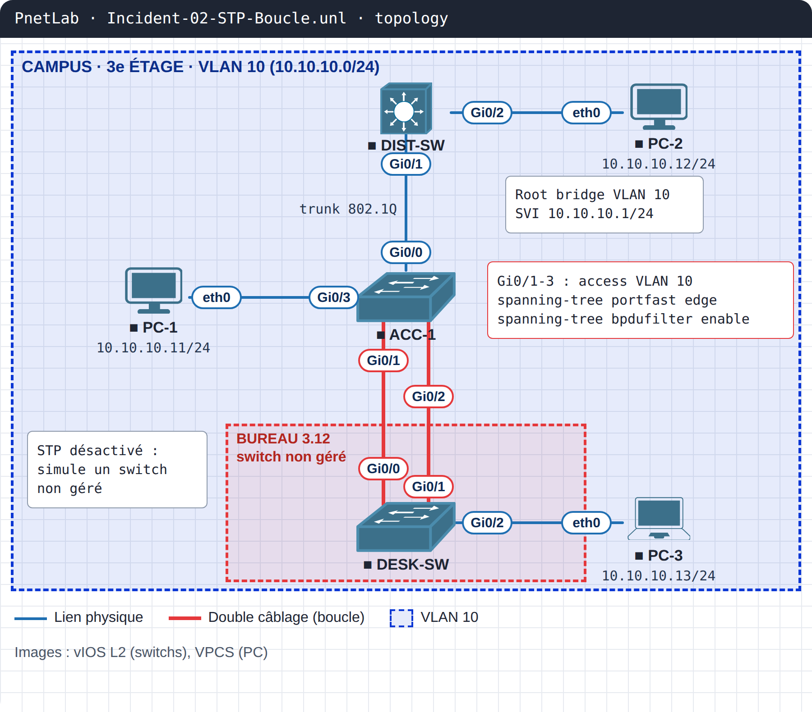

# INC-02 · Boucle de niveau 2 : tout un étage coupé par un switch de bureau

| Parcours | Niveau | Objectifs CCNA v2 | Plateforme | Durée |
|---|---|---|---|---|
| Incidents en entreprise | CCNA | 2.5.d PortFast et BPDU guard · 4.7.c storm control | PnetLab / EVE-NG (vIOS L2, VPCS) | 30 min |

!!! danger "Ticket INC-02 · Priorité P1"
    **Mardi 10 h 47.** Tout le 3e étage est coupé : plus de réseau, plus de téléphonie, les voyants des switchs clignotent en continu. Un nouveau collaborateur s'est installé ce matin au bureau 3.12 avec son propre petit switch.

## Topologie



| Équipement | Image | Rôle | Adresses / ports clés |
|---|---|---|---|
| DIST-SW | vIOS L2 | Distribution, root bridge VLAN 10 | SVI 10.10.10.1/24 · Gi0/1 trunk vers ACC-1 |
| ACC-1 | vIOS L2 | Accès du 3e étage | Gi0/0 trunk · Gi0/1-3 prises murales (VLAN 10) |
| DESK-SW | vIOS L2 | Switch de bureau non géré (STP désactivé) | Gi0/0 et Gi0/1 vers deux prises murales |
| PC-1, PC-2, PC-3 | VPCS | Postes | 10.10.10.11 · .12 · .13 /24 |

## Démarrer le lab

1. Importe la topologie du dossier `topology/` (images IOL et VPCS non fournies).
2. Applique les configurations de `configs/initial/`.
3. Les switchs vIOS L2 mettent 1 à 2 minutes à démarrer. Démarre DESK-SW **en dernier** : c'est lui qui déclenche la panne. La tempête consomme beaucoup de CPU sur ton serveur : arrête DESK-SW si besoin.

## Ta mission

1. Constate le symptôme : depuis PC-1, `ping 10.10.10.1` échoue ou répond de façon erratique.
2. Trouve dans les logs d'ACC-1 le message qui prouve la boucle.
3. Explique pourquoi Spanning Tree ne l'a pas bloquée (une commande `show` suffit).
4. Corrige **sans** désactiver Spanning Tree et **sans** compter sur l'utilisateur : le réseau doit se protéger seul la prochaine fois.
5. Valide : la tempête s'arrête, PC-1 et PC-2 se joignent, et le port fautif est isolé.

!!! tip "Indice"
    Regarde les compteurs de BPDU des ports d'accès d'ACC-1.

## Solution

??? success "Afficher la solution"
    **Diagnostic.** Les logs d'ACC-1 affichent `%SW_MATM-4-MACFLAP_NOTIF` : la même adresse MAC saute sans arrêt entre `Gi0/1` et `Gi0/2`. Les compteurs de broadcast explosent (`show interfaces gi0/1`).

    **Pourquoi STP n'a rien vu.** `show spanning-tree interface gi0/1 detail` affiche `Bpdu filter is enabled` et `BPDU: sent 0, received 0`. Avec BPDU filter, le port n'envoie ni ne lit aucune BPDU : Spanning Tree est aveugle sur ce port. Le switch de bureau a deux câbles vers deux prises : la boucle est parfaite.

    **Correction.**
    ```
    ACC-1(config)#spanning-tree portfast edge bpduguard default
    ACC-1(config)#interface range Gi0/1 - 3
    ACC-1(config-if-range)#no spanning-tree bpdufilter enable
    ACC-1(config-if-range)#spanning-tree bpduguard enable
    ACC-1(config-if-range)#storm-control broadcast level 1.00
    ACC-1(config-if-range)#storm-control action shutdown
    ```
    Dès qu'une BPDU revient par la boucle, BPDU guard passe le port en `err-disabled` (`%SPANTREE-2-BLOCK_BPDUGUARD`). Storm control sert de filet de sécurité si l'équipement branché ne relaie pas les BPDU.

    **Le piège.** Ajouter `bpdufilter` pour « faire taire » les messages BPDU guard : c'est exactement ce qui a rendu la boucle possible.

    **Remise en service.** Retirer le second câble du bureau 3.12, puis `shutdown` / `no shutdown` sur le port err-disabled. Configurations corrigées : `configs/final/`.

## Pour aller plus loin

Active `errdisable recovery cause bpduguard` avec un intervalle de 300 s et observe ce qui se passe si la boucle est toujours là : le port retombe en err-disabled à chaque tentative.

## Ressources

- Vidéo : à venir sur [TikTok](https://www.tiktok.com/@masterytechcenter) et [YouTube](https://www.youtube.com/@MasteryTechnologyCenter)
- Téléchargement du lab complet : [INC-02-boucle-stp-bpdufilter.zip](https://github.com/masterytechnologycenter/network-labs/releases/download/INC-02/INC-02-boucle-stp-bpdufilter.zip)
- Conception détaillée : [LLD](docs/LLD.md)
