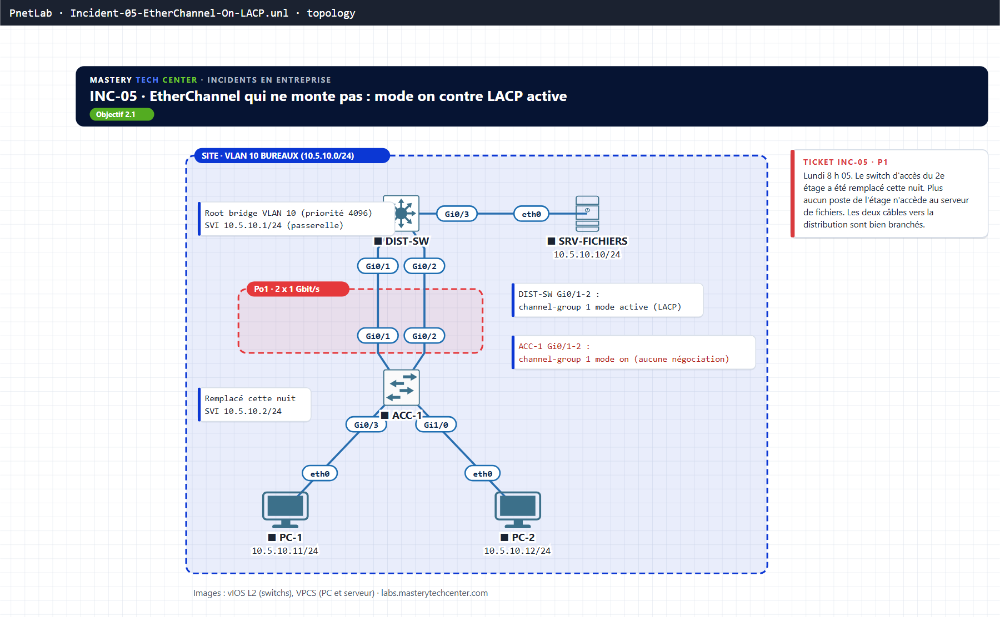

# INC-05 · EtherChannel qui ne monte pas : mode on contre LACP active

| Parcours | Niveau | Objectif CCNA v2 | Plateforme | Durée |
|---|---|---|---|---|
| Incidents en entreprise | CCNA | 2.1 EtherChannel (LACP) | PNETLab / EVE-NG (vIOS L2, VPCS) · Packet Tracer | 20 min |

<!-- import-lab -->
!!! download "Importer ce lab dans EVE-NG ou PNETLab"

    [:material-download: Télécharger le .zip](topology/Incident-05-EtherChannel-On-LACP.zip){ .md-button .md-button--primary }
    [Le fichier .unl seul](topology/Incident-05-EtherChannel-On-LACP.unl){ .md-button }

    **EVE-NG** : menu *Import*, choisis le `.zip`. **PNETLab** : importe le `.zip` ou le `.unl`.
    Testé sur EVE-NG Community 5.0.1 et PNETLab. Les images (IOL, vIOS, VPCS, Palo Alto…) ne sont pas fournies : si le nom de ton image diffère, choisis la tienne dans les réglages du nœud.
<!-- /import-lab -->

!!! danger "Ticket INC-05 · Priorité P1"
    **Lundi 8 h 05.** Le switch d'accès du 2e étage a été remplacé cette nuit par un prestataire. Ce matin, plus aucun poste de l'étage n'accède au serveur de fichiers. Les deux câbles vers le switch de distribution sont bien branchés.

## Topologie



| Équipement | Image | Rôle | Adresses / ports clés |
|---|---|---|---|
| DIST-SW | vIOS L2 | Distribution, root bridge VLAN 10, passerelle | Gi0/1-2 → Po1 (LACP active) · Gi0/3 SRV-FICHIERS · SVI 10.5.10.1/24 |
| ACC-1 | vIOS L2 | Accès du 2e étage, remplacé cette nuit | Gi0/1-2 → Po1 · Gi0/3 PC-1 · Gi1/0 PC-2 · SVI 10.5.10.2/24 |
| SRV-FICHIERS | VPCS | Serveur de fichiers | 10.5.10.10/24 |
| PC-1, PC-2 | VPCS | Postes de l'étage | 10.5.10.11 · .12 /24 |

## Démarrer le lab

1. Importe `topology/Incident-05-EtherChannel-On-LACP.unl` (images vIOS L2 et VPCS non fournies). Les configurations de départ, avec la panne, se chargent au démarrage.
2. Les switchs vIOS L2 mettent 1 à 2 minutes à démarrer. Attends encore 1 à 2 minutes avant de constater le symptôme.
3. **Packet Tracer :** construis le lab avec [docs/PACKET-TRACER.md](docs/PACKET-TRACER.md) (deux 2960-24TT).

## Ta mission

1. Constate le symptôme : depuis PC-1, `ping 10.5.10.10`.
2. Regarde l'état du Port-channel 1 **des deux côtés** : quelles lettres entre parenthèses ?
3. Trouve pourquoi le switch de distribution n'a aucun voisin LACP.
4. Corrige **sans** toucher au switch de distribution (son gabarit est le standard du site).
5. Valide : `Po1(SU)`, les deux ports en `(P)` des deux côtés, et le ping vers le serveur passe.

!!! tip "Indice"
    Un côté affiche peut-être que tout va bien. Compare la ligne `channel-group` des deux switchs.

## Vérifie avec

```
show etherchannel summary
show lacp neighbor
show running-config | include channel-group
show logging | include EC-
```

## Solution

??? success "Afficher la solution"
    **Cause.** ACC-1 est en `channel-group 1 mode on` : il force le canal sans jamais envoyer de message LACP. DIST-SW est en `mode active` : il envoie des messages LACP et attend une réponse qui ne vient jamais. Il **suspend** donc ses deux ports (`Po1(SD)`, `Gi0/1(s)`, `Gi0/2(s)`), avec le message `%EC-5-L3DONTBNDL2: Gi0/1 suspended: LACP currently not enabled on the remote port.` En face, ACC-1 affiche `Po1(SU)` et ses ports en `(P)` : de son côté, tout semble normal. C'est pourquoi il faut toujours regarder **les deux côtés**.

    **Correction, sur ACC-1.** IOS refuse de passer directement de `on` à `active` (« Command rejected: is already part of a channel with a different type of protocol enabled »). Il faut d'abord retirer l'ancien réglage :
    ```
    ACC-1(config)#interface range GigabitEthernet0/1 - 2
    ACC-1(config-if-range)#no channel-group 1 mode on
    ACC-1(config-if-range)#channel-group 1 mode active
    ```
    Sur vIOS L2, `no channel-group 1` seul répond `% Incomplete command.` : on retire la ligne exacte.

    **Le piège.** Passer DIST-SW en `mode on`, lui aussi. Le canal monte, mais sans aucune négociation : plus rien ne vérifie que les deux câbles arrivent sur le même switch, réglé de la même façon. Le standard du site reste LACP.

    **À retenir.** `on` ne fonctionne qu'avec `on`. Avec LACP, au moins un côté en `active` : `active`/`active` ou `active`/`passive`. Jamais `passive`/`passive`, jamais `on` face à LACP.

    Configurations corrigées : `configs/final/`.

## Ressources

- Vidéo : à venir sur [TikTok](https://www.tiktok.com/@masterytechcenter) et [YouTube](https://www.youtube.com/@MasteryTechnologyCenter)
- Téléchargement du lab complet : [INC-05-etherchannel-on-lacp.zip](https://github.com/masterytechnologycenter/network-labs/releases/download/INC-05/INC-05-etherchannel-on-lacp.zip)
- Conception détaillée : [LLD](docs/LLD.md)
- Lab voisin, dans la formation CCNA (bientôt en ligne) : LAB 2.1 · L'EtherChannel ne monte pas (passive contre passive)
