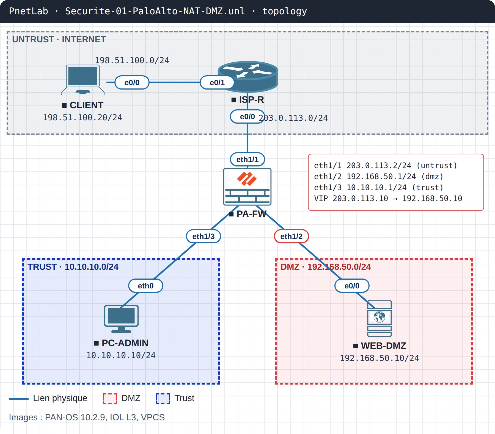

# SEC-01 · Palo Alto : la DMZ injoignable après un NAT

| Parcours | Niveau | Thème | Plateforme | Durée |
|---|---|---|---|---|
| Sécurité réseau | Intermédiaire (PCNSA / PCNSE) | NAT de destination et règles de sécurité PAN-OS | PnetLab / EVE-NG (PAN-OS 10.2, IOL, VPCS) | 30 min |

!!! danger "Ticket INC0042390 · Priorité P2"
    **Lundi 8 h 02.** Le nouveau site web de l’entreprise, publié ce week-end en DMZ derrière le Palo Alto, est injoignable depuis Internet. Le NAT a été vérifié deux fois, la règle de sécurité existe… et rien ne passe.

## Topologie



| Équipement | Image | Rôle | Adresses |
|---|---|---|---|
| CLIENT | IOL L3 | Internaute | e0/0 198.51.100.20/24 |
| ISP-R | IOL L3 | Internet simulé | e0/1 198.51.100.1/24 · e0/0 203.0.113.1/24 |
| PA-FW | PAN-OS 10.2.9 | Pare-feu | eth1/1 untrust 203.0.113.2/24 · eth1/2 dmz 192.168.50.1/24 · eth1/3 trust 10.10.10.1/24 |
| WEB-DMZ | IOL L3 (serveur HTTP) | Serveur web publié | e0/0 192.168.50.10/24 · IP publique 203.0.113.10 |
| PC-ADMIN | VPCS | Poste du LAN | 10.10.10.10/24 |

## Démarrer le lab

1. Importe la topologie du dossier `topology/` (images non fournies).
2. Les configurations IOL et VPCS sont chargées au démarrage. Pour le pare-feu, colle en mode `configure` le contenu de `configs/initial/PA-FW.set.txt`, puis `commit`. PAN-OS met plusieurs minutes à démarrer.
3. Depuis CLIENT : `telnet 203.0.113.10 80` doit échouer.

## Ta mission

1. Vérifie que le NAT de destination est correct.
2. Trouve pourquoi la règle de sécurité `DMZ-WEB` ne laisse rien passer.
3. Prouve-le avec une seule commande du pare-feu.
4. Corrige **sans** mettre `any` en destination, et sans élargir le service.
5. Valide : `telnet 203.0.113.10 80` depuis CLIENT affiche `Open`.

!!! tip "Indice"
    Avec quelle adresse de destination PAN-OS évalue-t-il une règle de sécurité : avant ou après le NAT ?

## Solution

??? success "Afficher la solution"
    **Cause.** PAN-OS évalue la règle de sécurité avec l’adresse de destination **d’origine** (avant NAT, ici 203.0.113.10) et la zone de destination **finale** (après NAT, ici `dmz`). La règle `DMZ-WEB` avait été écrite avec l’adresse privée du serveur (192.168.50.10) : elle ne correspond jamais.

    **Preuve.**
    ```
    test security-policy-match from untrust to dmz source 198.51.100.20 destination 203.0.113.10 protocol 6 destination-port 80
    ```
    Avant correction, aucune règle `DMZ-WEB` n’est renvoyée. Après correction, la règle apparaît avec `action allow`.

    **Correction.**
    ```
    configure
    set rulebase security rules DMZ-WEB destination WEB-PUBLIC
    delete rulebase security rules DMZ-WEB destination WEB-PRIVE
    commit
    ```

    **Le piège.** Mettre `any` en destination fait passer le trafic… et ouvre toute la DMZ à Internet.

    Configuration corrigée : `configs/final/PA-FW.set.txt`.

## Pour aller plus loin

Ajoute un second serveur en DMZ (192.168.50.20) publié sur 203.0.113.11, et écris ses règles NAT et de sécurité du premier coup. Vérifie avec `test security-policy-match` avant de tester depuis CLIENT.

## Ressources

- Vidéo : à venir sur [TikTok](https://www.tiktok.com/@masterytechcenter) et [YouTube](https://www.youtube.com/@MasteryTechnologyCenter)
- Téléchargement du lab complet : [SEC-01-paloalto-nat-dmz.zip](https://github.com/masterytechnologycenter/network-labs/releases/download/SEC-01/SEC-01-paloalto-nat-dmz.zip)
- Conception détaillée : [LLD](docs/LLD.md)
