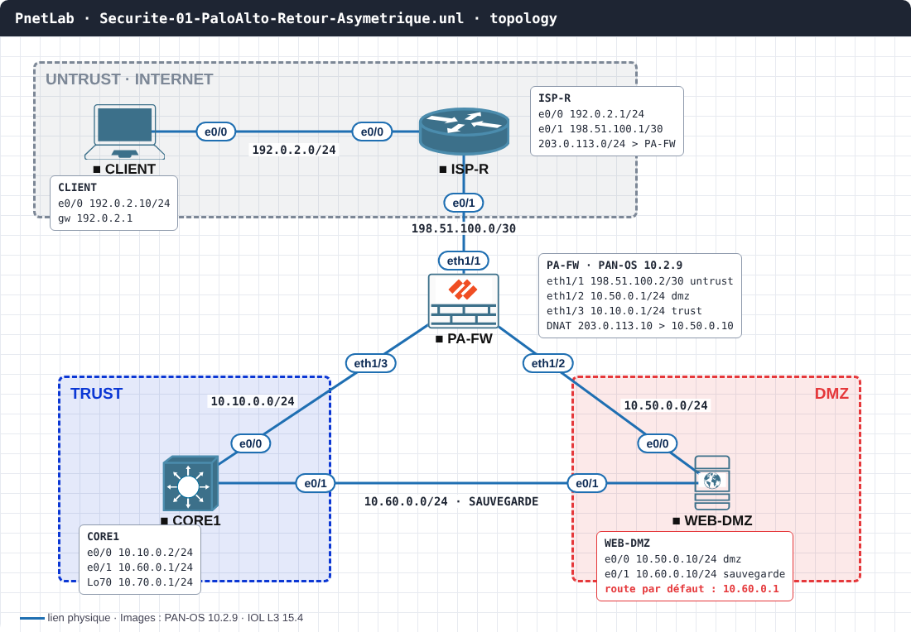

# SEC-01 · DMZ : le site web coupé par une carte de sauvegarde

**Série :** Incidents sécurité · **Niveau :** intermédiaire · **Auteur :** Hilaire TCHOUATEU
**Versions testées :** Palo Alto PAN-OS 10.2.9 · IOL L3 15.4 (en rôle d'hôte et de serveur)

## Le ticket

> **INC0051207 · P1 · Site web client injoignable depuis Internet**
> Lundi, 8 h 41. Le site public ne répond plus depuis Internet. Rien n'a changé sur le pare-feu. Vendredi soir, la fenêtre de changement a servi à brancher une carte de sauvegarde sur le serveur web de la DMZ.

## Topologie



| Équipement | Rôle | Interfaces et adresses |
| --- | --- | --- |
| `CLIENT` | Poste sur Internet | e0/0 `192.0.2.10/24`, passerelle `192.0.2.1` |
| `ISP-R` | Routeur du fournisseur d'accès | e0/0 `192.0.2.1/24` · e0/1 `198.51.100.1/30` · route `203.0.113.0/24` vers `PA-FW` |
| `PA-FW` | Pare-feu Palo Alto | eth1/1 `198.51.100.2/30` (untrust) · eth1/2 `10.50.0.1/24` (dmz) · eth1/3 `10.10.0.1/24` (trust) |
| `CORE1` | Cœur de réseau interne | e0/0 `10.10.0.2/24` · e0/1 `10.60.0.1/24` (sauvegarde) · Lo70 `10.70.0.1/24` (dépôt de sauvegarde) |
| `WEB-DMZ` | Serveur web | e0/0 `10.50.0.10/24` (dmz) · e0/1 `10.60.0.10/24` (sauvegarde) |

Le site est publié en HTTPS sous l’adresse publique `203.0.113.10` (NAT de destination vers `10.50.0.10`). Le port 80 reste ouvert, comme en production, seulement pour rediriger vers HTTPS.

## Mise en route

1. Importe `topology/Securite-01-PaloAlto-Retour-Asymetrique.unl` dans PnetLab ou EVE-NG et démarre les nœuds (le Palo Alto met plusieurs minutes).
2. Les IOL chargent leur configuration seuls. Pour `PA-FW` : connexion `admin` / `admin`, changement du mot de passe, puis `configure` et colle `configs/initial/PA-FW.txt`.

## Ta mission

Depuis `CLIENT`, le site ne répond pas :

```
CLIENT#telnet 203.0.113.10 443
```

Trouve la cause, prouve-la avec une commande, répare, puis vérifie que `CLIENT` ouvre la connexion.
Contraintes : la règle de sécurité et le NAT du pare-feu sont corrects et ne doivent pas changer ; la sauvegarde vers `10.70.0.0/24` doit continuer à fonctionner.

## Indice

Une seule chose a changé vendredi soir. Regarde par où le serveur envoie ses réponses.

??? success "Solution"
    **Cause.** Avec la carte de sauvegarde, la route par défaut de `WEB-DMZ` a été posée vers `10.60.0.1` (`CORE1`). Le pare-feu voit la requête entrer par `eth1/1` et la traduit vers le serveur, mais la réponse revient par le cœur de réseau et arrive sur `eth1/3`, une autre interface et une autre zone. Le pare-feu ne voit jamais le retour attendu : la session reste incomplète.

    **Preuve.**

    ```
    admin@PA-FW> show session all filter source 192.0.2.10
    WEB-DMZ#show ip route 0.0.0.0
    ```

    La session porte l’application `incomplete` : la poignée de main TCP ne se termine jamais, et la route par défaut du serveur pointe vers `10.60.0.1`.

    **Correction** sur `WEB-DMZ` :

    ```
    WEB-DMZ(config)#no ip route 0.0.0.0 0.0.0.0 10.60.0.1
    WEB-DMZ(config)#ip route 0.0.0.0 0.0.0.0 10.50.0.1
    WEB-DMZ(config)#ip route 10.70.0.0 255.255.255.0 10.60.0.1
    ```

    **Vérification.** `CLIENT#telnet 203.0.113.10 443` répond `Open`, et `WEB-DMZ#ping 10.70.0.1` répond toujours.

    **À ne pas faire.** Désactiver le contrôle TCP hors session du pare-feu : la panne n'est pas sur le pare-feu, et tu affaiblis sa protection pour tous les flux.

## Pour aller plus loin

- Rends la règle `WEB-IN` plus stricte (application `web-browsing`) et vérifie qu'elle ne change rien à la panne.
- Rends le retour symétrique par conception : carte de sauvegarde dans un VRF ou une table de routage distincte.
- Écris la check-list de changement « ajout d'une carte réseau » : table de routage, test aller et retour, test de la sauvegarde.

## Ressources

- Conception détaillée : [docs/LLD.md](docs/LLD.md)
- Configurations avec la panne : `configs/initial/` · corrigées : `configs/final/`
- Tous les labs : labs.masterytechcenter.com
