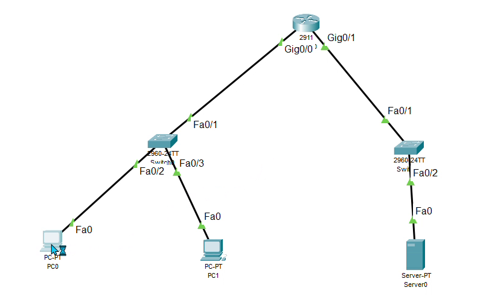

# PT-TP01 · Le réseau d'un petit bureau… et la passerelle oubliée

| Parcours | Niveau | Objectif CCNA v2 | Plateforme | Durée |
|---|---|---|---|---|
| TP Packet Tracer | Débutant | 1.3 adressage IPv4 · 1.6 dépanner un client filaire | Cisco Packet Tracer | 15 à 20 min |

Le TP de la vidéo **TP Packet Tracer #1** : on construit le réseau d'un petit bureau de zéro, puis on trouve la panne que tout débutant fait au moins une fois.

**[Télécharger le fichier Packet Tracer (.pkt)](topology/PT-TP01-petit-bureau.pkt)**

Le fichier a été enregistré avec Packet Tracer 9.0.1 : une version plus ancienne peut refuser de l'ouvrir. Dans ce cas, construis le réseau toi-même avec les tableaux ci-dessous, en 10 minutes.

## Topologie



```
 PC0 ─┐                                      ┌─ Server0
 PC1 ─┴─ Switch0 ─ Gi0/0 [Router0] Gi0/1 ─ Switch1
        BUREAU 192.168.10.0/24     SERVEURS 192.168.20.0/24
```

| Appareil | Modèle Packet Tracer | Port | Adresse | Passerelle |
|---|---|---|---|---|
| Router0 | 2911 | Gi0/0 (vers Switch0 Fa0/1) | 192.168.10.1/24 | — |
| Router0 | 2911 | Gi0/1 (vers Switch1 Fa0/1) | 192.168.20.1/24 | — |
| PC0 | PC-PT | Fa0 → Switch0 Fa0/2 | 192.168.10.10/24 | 192.168.10.1 |
| PC1 | PC-PT | Fa0 → Switch0 Fa0/3 | 192.168.10.11/24 | 192.168.10.1 |
| Server0 | Server-PT | Fa0 → Switch1 Fa0/2 | 192.168.20.10/24 | 192.168.20.1 |
| Switch0, Switch1 | 2960-24TT | — | sans configuration | — |

Tous les câbles sont des câbles droits (Copper Straight-Through).

## Ta mission

1. **Construis le réseau** (ou ouvre le `.pkt`). Côté routeur, les liens restent rouges : ses interfaces sont éteintes par défaut.
2. **Configure le routeur** : une adresse par réseau, puis `no shutdown`. Vérifie avec `show ip interface brief` : Gi0/0 et Gi0/1 doivent être `up / up`.
3. **Configure Server0 et PC1** (Desktop → IP Configuration), **avec** leur passerelle.
4. **Configure PC0** avec une adresse et un masque… **et laisse la passerelle vide** (Default Gateway 0.0.0.0). Si tu as ouvert le `.pkt` et qu'elle est remplie, efface-la pour reproduire la panne.
5. Depuis PC0 (Desktop → Command Prompt) :
   - `ping 192.168.10.11` (PC1) : ça répond ;
   - `ping 192.168.20.10` (Server0) : `Request timed out`. **Pourquoi ?**

??? tip "Indice"
    Compare l'adresse de destination avec le réseau de PC0. Le serveur est-il dans le même réseau ?

## Solution

??? success "Afficher la solution"
    **La cause :** la passerelle de PC0 est vide. Un PC n'utilise sa passerelle que pour joindre une adresse **hors de son réseau**. PC1 est dans 192.168.10.0/24, comme PC0 : le ping passe. Le serveur est dans 192.168.20.0/24 : pour l'atteindre, PC0 doit passer par le routeur, mais personne ne lui a dit où il est.

    **La correction :** sur PC0, Default Gateway = `192.168.10.1`.

    **Configuration du routeur :**
    ```
    enable
    configure terminal
    interface GigabitEthernet0/0
     ip address 192.168.10.1 255.255.255.0
     no shutdown
    interface GigabitEthernet0/1
     ip address 192.168.20.1 255.255.255.0
     no shutdown
    end
    show ip interface brief
    ```

    **Ce que tu dois voir après la correction :**

    - le premier ping vers le serveur peut se perdre (`Request timed out`) : le temps que l'adresse MAC soit apprise (ARP). Les suivants répondent ;
    - **TTL=128** dans les réponses de PC1, **TTL=127** dans celles du serveur : un de moins, la preuve qu'un routeur a été traversé.

## Pour aller plus loin

Passe en mode **Simulation** (en bas à droite), filtre sur ICMP, et relance le ping de PC0 vers le serveur. Clique sur l'enveloppe à chaque étape : PC0, Switch0, Router0, Switch1, Server0… et retour.
