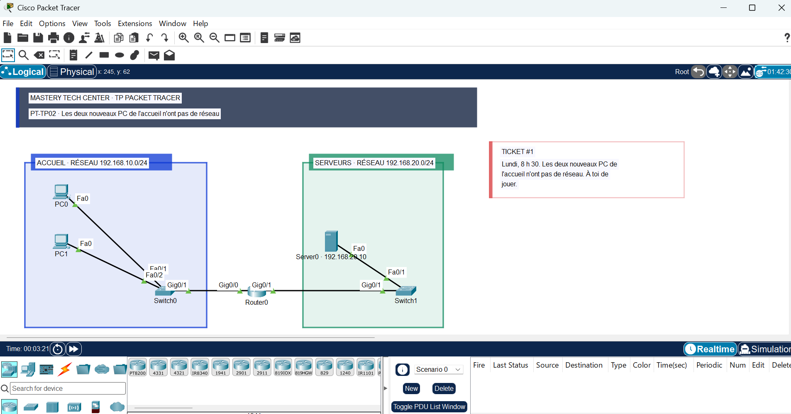

# PT-TP02 · Les deux nouveaux PC de l'accueil n'ont pas de réseau

| Parcours | Niveau | Objectif CCNA v2 | Plateforme | Durée |
|---|---|---|---|---|
| TP Packet Tracer | Débutant | 1.7 DHCPv4 (relais DHCP) | Cisco Packet Tracer | 15 à 20 min |

Le TP de la vidéo **Ton premier jour d'admin · ticket #1**. On reprend le petit bureau de [PT-TP01](../PT-TP01-petit-bureau/README.md) : le serveur de la salle des serveurs devient serveur DHCP, les PC de l'accueil passent en DHCP… et ne reçoivent que **169.254.x.x**.

> **TICKET #1** · Lundi, 8 h 30. Les deux nouveaux PC de l'accueil n'ont pas de réseau. À toi de jouer.

**[Télécharger le fichier Packet Tracer (.pkt)](topology/PT-TP02-dhcp.pkt)**

Le fichier a été enregistré avec Packet Tracer 9.0.1 : une version plus ancienne peut refuser de l'ouvrir. Dans ce cas, construis le réseau toi-même avec les tableaux ci-dessous.

## Topologie



```
 PC0 ─┐                                      ┌─ Server0 (serveur DHCP)
 PC1 ─┴─ Switch0 ─ Gi0/0 [Router0] Gi0/1 ─ Switch1
        ACCUEIL 192.168.10.0/24    SERVEURS 192.168.20.0/24
```

| Appareil | Modèle Packet Tracer | Port | Adresse | Passerelle |
|---|---|---|---|---|
| Router0 | 2911 | Gi0/0 (vers Switch0 Gi0/1) | 192.168.10.1/24 | — |
| Router0 | 2911 | Gi0/1 (vers Switch1 Gi0/1) | 192.168.20.1/24 | — |
| PC0 | PC-PT | Fa0 → Switch0 Fa0/1 | **DHCP** | donnée par le DHCP |
| PC1 | PC-PT | Fa0 → Switch0 Fa0/2 | **DHCP** | donnée par le DHCP |
| Server0 | Server-PT | Fa0 → Switch1 Fa0/1 | 192.168.20.10/24 | 192.168.20.1 |
| Switch0, Switch1 | 2960-24TT | — | sans configuration | — |

**Le serveur DHCP** (Server0 → Services → DHCP, service **On**) : pool `BUREAU`, passerelle `192.168.10.1`, DNS `0.0.0.0`, première adresse `192.168.10.100`, masque `255.255.255.0`, 50 adresses au maximum.

## Ta mission

1. **Ouvre le `.pkt`.** Il a été enregistré à la fin de la vidéo : le réseau marche déjà. Pour jouer le ticket, retire d'abord la correction sur Router0 (onglet CLI) :
   ```
   enable
   configure terminal
   interface GigabitEthernet0/0
    no ip helper-address 192.168.20.10
   end
   ```
2. **PC1** → Desktop → IP Configuration : coche **Static**, puis **DHCP**. L'adresse obtenue commence par **169.254** : le PC n'a reçu aucune réponse.
3. Pourtant, Server0 a bien un service DHCP allumé, avec un pool pour le réseau de l'accueil. **Pourquoi la demande n'arrive-t-elle pas jusqu'à lui ?**

??? tip "Indice"
    Un PC qui n'a pas encore d'adresse ne connaît ni le serveur ni la passerelle. Il envoie sa demande à **tout le monde** (une diffusion, ou *broadcast*). Qui se trouve entre PC1 et Server0, et que fait-il des diffusions ?

## Solution

??? success "Afficher la solution"
    **La cause :** la demande DHCP du PC est une diffusion. Un routeur ne fait pas passer les diffusions d'un réseau à l'autre : la demande s'arrête sur Gi0/0 de Router0 et n'atteint jamais Server0, qui est dans un autre réseau. Sans réponse, le PC se donne lui-même une adresse **169.254.x.x** (adresse locale au lien), qui ne permet de joindre personne en dehors de son câble.

    **La correction :** demander au routeur de **relayer** les demandes DHCP vers le serveur, sur l'interface qui les **reçoit**, celle de l'accueil :
    ```
    enable
    configure terminal
    interface GigabitEthernet0/0
     ip helper-address 192.168.20.10
    end
    show ip interface GigabitEthernet0/0
    ```
    Dans la sortie, cherche la ligne `Helper address is 192.168.20.10`.

    **Pourquoi le serveur choisit le bon pool :** en relayant la demande, le routeur y écrit l'adresse de son interface Gi0/0, 192.168.10.1 (le champ *giaddr*). Le serveur sait ainsi que le client est dans 192.168.10.0/24, et il lui donne une adresse du pool `BUREAU`.

    **Ce que tu dois voir après la correction :** sur PC1 puis PC0, Static puis DHCP → une adresse en **192.168.10.1xx**, passerelle **192.168.10.1**. Depuis PC0 (Command Prompt) : `ipconfig`, puis `ping 192.168.20.10`, qui répond.

## Pour aller plus loin

Passe en mode **Simulation** (en bas à droite), **Edit Filters** : ne garde que **DHCP**. Sur PC1, coche Static puis DHCP, ferme la fenêtre et avance avec **Capture/Forward**. Tu vois la demande aller de PC1 au routeur, du routeur à Server0, et la réponse revenir jusqu'à PC1. Refais-le sans `ip helper-address` : l'enveloppe s'arrête au routeur.

**Source :** Cisco, *IP Addressing: DHCP Configuration Guide*, chapitre *Configuring the Cisco IOS DHCP Relay Agent*.
