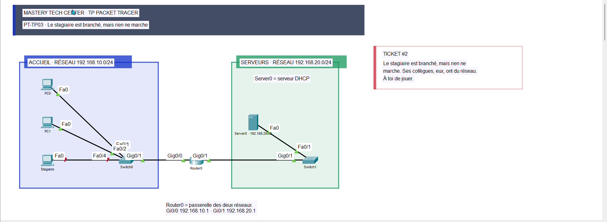

# PT-TP03 · Le stagiaire est branché, mais rien ne marche

| Parcours | Niveau | Objectif CCNA v2 | Plateforme | Durée |
|---|---|---|---|---|
| TP Packet Tracer | Débutant | 1.1 Diagnostiquer les problèmes d'interface et de câble | Cisco Packet Tracer | 10 à 15 min |

Le TP de la vidéo **Ton premier jour d'admin · ticket #2**. On reprend le réseau de [PT-TP02](../PT-TP02-relais-dhcp/README.md), relais DHCP compris : les PC de l'accueil ont leur adresse. On y ajoute le PC du **stagiaire**, branché sur le switch de l'accueil… et rien ne marche.

> **TICKET #2** · Le stagiaire est branché, mais rien ne marche. Ses collègues, eux, ont du réseau. À toi de jouer.

**[Télécharger le fichier Packet Tracer (.pkt)](topology/PT-TP03-panne.pkt)**

Ce fichier contient **la panne** : tu peux la résoudre toi-même. Il a été enregistré avec Packet Tracer 9.0.1 : une version plus ancienne peut refuser de l'ouvrir. Dans ce cas, construis le réseau toi-même avec les tableaux ci-dessous.

## Topologie



```
 PC0 ───────┐                                       ┌─ Server0 (serveur DHCP)
 PC1 ───────┼─ Switch0 ─ Gi0/0 [Router0] Gi0/1 ─ Switch1
 Stagiaire ─┘ (Fa0/4)
        ACCUEIL 192.168.10.0/24      SERVEURS 192.168.20.0/24
```

| Appareil | Modèle Packet Tracer | Port | Adresse | Passerelle |
|---|---|---|---|---|
| Router0 | 2911 | Gi0/0 (vers Switch0 Gi0/1) | 192.168.10.1/24, `ip helper-address 192.168.20.10` | — |
| Router0 | 2911 | Gi0/1 (vers Switch1 Gi0/1) | 192.168.20.1/24 | — |
| PC0 | PC-PT | Fa0 → Switch0 Fa0/1 | DHCP | donnée par le DHCP |
| PC1 | PC-PT | Fa0 → Switch0 Fa0/2 | DHCP | donnée par le DHCP |
| **Stagiaire** | PC-PT | Fa0 → Switch0 **Fa0/4** | DHCP | donnée par le DHCP |
| Server0 | Server-PT | Fa0 → Switch1 Fa0/1 | 192.168.20.10/24 | 192.168.20.1 |

**Le serveur DHCP** (Server0 → Services → DHCP, service **On**) : pool `BUREAU`, passerelle `192.168.10.1`, DNS `0.0.0.0`, première adresse `192.168.10.100`, masque `255.255.255.0`, 50 adresses au maximum.

## Ta mission

1. **Ouvre le `.pkt`.** Regarde le câble du stagiaire sur le schéma : de quelle couleur sont ses points ?
2. **Stagiaire** → Desktop → IP Configuration : coche **Static**, puis **DHCP**. Les champs restent vides : le PC n'obtient aucune adresse.
3. **PC1** → IP Configuration : lui a bien son adresse en 192.168.10.1xx. Le serveur DHCP marche donc. **Où est le problème ?**

??? tip "Indice"
    Si les collègues reçoivent leur adresse, le serveur et le routeur ne sont pas en cause. Le problème est entre le PC du stagiaire et le switch. Sur Switch0 (onglet CLI), regarde l'état de chaque port : `enable`, puis `show ip interface brief`.

## Solution

??? success "Afficher la solution"
    **La cause :** le port **FastEthernet0/4** de Switch0, celui du stagiaire, a été désactivé à la main avec `shutdown`. Le câble est bon, mais le lien ne peut pas monter : les points restent rouges, et le PC ne peut même pas envoyer sa demande DHCP.

    Le journal du switch le dit dès l'ouverture de la CLI :
    ```
    %LINK-5-CHANGED: Interface FastEthernet0/4, changed state to administratively down
    ```
    Et `show ip interface brief` le confirme :
    ```
    FastEthernet0/4   unassigned   YES manual administratively down down
    ```
    « administratively down » veut dire : coupé par une commande, pas par une panne de câble.

    **La correction :** réactiver le port.
    ```
    enable
    configure terminal
    interface FastEthernet0/4
     no shutdown
    end
    show ip interface brief
    ```
    Le switch annonce `Interface FastEthernet0/4, changed state to up`, et la ligne Fa0/4 passe en `up up`.

    **Ce que tu dois voir après la correction :** les points du câble passent à l'orange quelques secondes, puis au vert (tu peux accélérer avec **Fast Forward Time**). Sur le Stagiaire, Static puis DHCP → une adresse en **192.168.10.1xx**, passerelle **192.168.10.1**. Dans Command Prompt : `ping 192.168.20.10`, qui répond 4 fois sur 4.

    **Pourquoi ce port était coupé :** désactiver les prises qui ne servent pas est une bonne pratique de sécurité (personne ne peut s'y brancher). Mais quand on attribue la prise à quelqu'un, il faut penser à la réactiver.

## Pour aller plus loin

Remets la panne (`shutdown` sur Fa0/4), puis compare avec un câble simplement débranché : supprime le câble du stagiaire et regarde ce que montre `show ip interface brief` pour Fa0/4. Le port est alors `down`, et non `administratively down` : c'est ce mot qui te dit si quelqu'un l'a coupé.

**Source :** Cisco, *Troubleshoot Switch Port and Interface Problems* (« If a port or module is manually shut down on one side of the link or the other, the link does not come up »).
